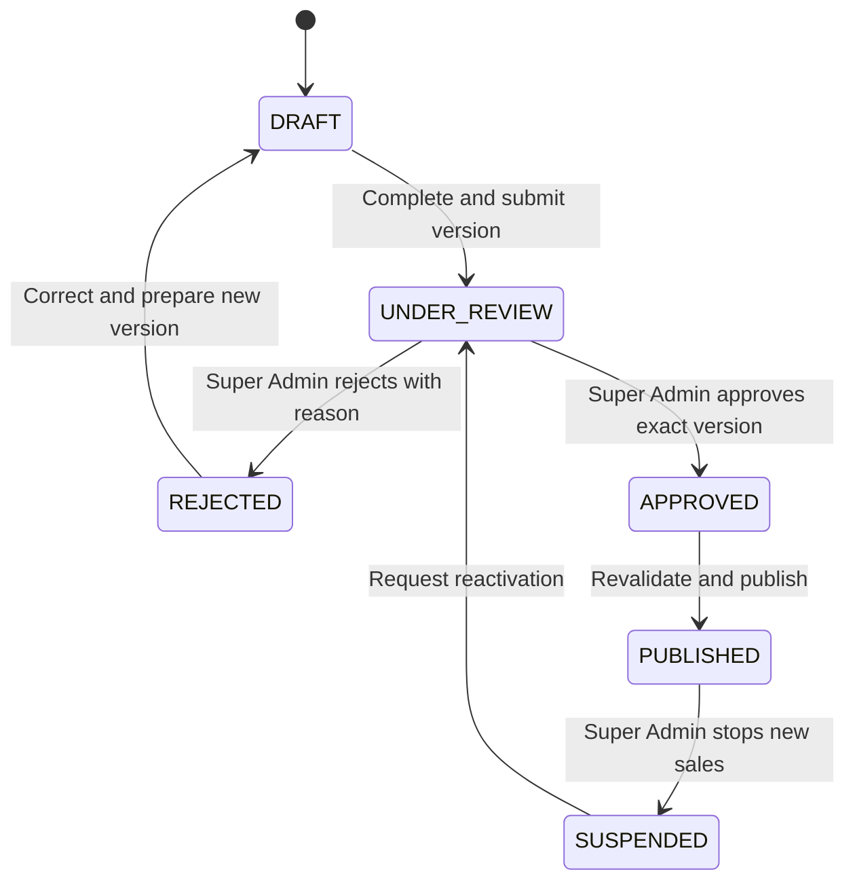

# Readify / ZEROTHAM: whole-flow implementation plan

Date: 11 November 2026 · Status: local implementation and verification recorded in `WORKFLOW_PROGRESS.md`; staging gates remain

## 1. Outcome and scope

Super Admin manages the platform through a central overview and partner-specific workspaces. Approved partners prepare complete listings as drafts, submit an exact version for review, and receive a clear decision. Customer-visible content becomes live only after Super Admin approval and publication. Later content changes must never overwrite the approved live version before review.

Primary implementation: `readify-india-multitenant` and its PostgreSQL/Supabase migrations. Verify `application-readify` against the resulting public views, RPCs, checkout APIs, and customer states. Change mobile code only where the contract or customer feedback requires it; preserve its ZEROTHAM branding and existing purchases.

This plan supersedes conflicting workflow proposals in the older `docs/PLAN.md`; it does not establish which migrations are deployed. Local source was audited; the Vercel Facilities failure has not been reproduced or diagnosed. This was the original planning baseline. Subsequent code changes and verification are recorded in `WORKFLOW_PROGRESS.md`; remote migration/deployment has not been performed.

The edge-case register below is a verification baseline, not a claim that unknown production failures are impossible. Newly discovered cases must be added before the affected phase is closed.

## 2. Rules and assumptions

| Rule | Planned behavior |
| --- | --- |
| Account approval is separate from listing approval | An approved partner can log in and prepare drafts; this does not publish any listing. |
| Approval authority | Server-side checks require `SUPER_ADMIN` for application decisions, listing/document approval, revision approval, publication and reactivation. A permission grant alone must not turn another role into an approver. |
| Live content | Customer-facing views expose the approved, published content of an active, approved partner in an active, launch-enabled category. |
| Content changes | Profile, address, customer-visible facilities, prices, plans, operating hours, capacity, seats, media, trainers, menus, academics, and customer-visible owner replies require review. Inventory/status fields that alter customer offers are content changes too. |
| Daily operations — assumption | Attendance, support replies, team administration within existing permissions, customer booking actions and permitted cancellations continue immediately, with authorization and audit. They do not wait in the listing-content queue. Customer purchases never need manual Super Admin approval. |
| Safety controls | Super Admin can immediately suspend a listing/partner and disable a category. Do not require approval to stop new sales. Explicit reactivation/publication checks are required to resume. |
| Super Admin edits | Retain all management controls. Content edits use a proposed version and explicit Super Admin approval; Super Admin may approve its own edit. No silent live overwrite. |
| Financial rules | Preserve current cancellation eligibility: partner cancellation is refund-eligible; customer cancellation is refund-eligible before the start time. Preserve currency/amount conventions and gateway verification. |
| Scope | A partner is an organization and may have multiple listings/services. A requested registration service is not automatically permission to launch every category. |
| Employee access — assumption | Preserve existing partner-wide employee listing access in this delivery. Do not silently reinterpret the unused listing-assignment model. Owner-only controls remain restricted. |
| Disabled services | Build correct category-specific flows for Library, Gym, Co-working and Exam Hub. Do not automatically enable currently disabled services or sell unsupported products. |
| Existing records | Preserve IDs, customer purchase history, reservation windows and audit records. Existing published content becomes the approved baseline during migration. |

Business-policy choices to validate during implementation: whether every listing needs a cover photo; category-specific mandatory document/content requirements; whether listing assignments should restrict employees later; whether owner replies need the same approval policy as listing content. Proposed default here is to review owner replies because they are customer-visible. Do not invent commission/payout formulas, new cancellation policies, tax rules, or trainer/course booking products.

## 3. Current foundation and gaps

| Area | Preserve/reuse | Complete |
| --- | --- | --- |
| Partner applications | Registration, inactive pending accounts, Super Admin decision, session status checks | Reliable decision history, duplicate/retry handling, dashboard queues and links |
| Listings | Draft/review/approve/publish lifecycle, verification, category tabs | Complete setup wizard, reusable readiness validator, immutable reviewed versions |
| Changes | `ListingChange`, transactional locking, deferred Library content updates | Draft revision editing, version conflicts, related-record dependencies, all category content |
| Partner profiles | Contact information, application decision, team, listings | Full partner workspace and explicit authorized partner filters |
| Platform overview | Listing totals, published/rejected/pending counts | Actual-live metrics, application/revision/document queues, support/issues, platform-only boundary |
| Operations | Bookings, plans/subscriptions, occupancy, payments, customers, attendance, support | Reuse within the selected partner; service-aware modules; accurate counts/pagination |
| Customer app | Supabase discovery/read contracts; server checkout/verification | Approved-only visibility, disabled/unavailable states and old-client compatibility |
| Facilities | Save action and deferred change path | Diagnose #441; honest queued/saved feedback; resilient refresh and selection state |

Main source locations: `src/lib/rbac.ts`, `src/lib/auth.ts`, `src/lib/listing-changes.ts`, `src/config/permissions.ts`, `src/config/nav.ts`, `src/server/actions/`, `src/app/(admin)/partners/[id]/page.tsx`, `src/app/(admin)/vendors/`, `prisma/schema.prisma`, and `prisma/migrations/`.

## 4. End-to-end journeys

### A. Partner application and account access

1. Applicant selects an active service and submits validated organization/account details.
2. Create the account, partner and application atomically; partner remains inactive and pending. Notify reviewers after successful persistence.
3. Super Admin opens the application from the central queue or partner profile, checks details and approves or rejects with a reason.
4. Approval enables partner login. Rejection leaves login disabled, with a recoverable correction/reapplication path rather than duplicate account creation.
5. Repeated decisions must return the existing outcome or a clear conflict. Reapplication needs a new application version/history, not silent erasure of the previous decision.
6. Account suspension, role removal or partner deactivation invalidates access on the next protected request.

### B. Complete draft setup

Use a resumable wizard backed by the same services used by detail-page editing:

1. Basic details and allowed service.
2. Contact, mapped address and timezone.
3. Required verification document uploads.
4. Facilities, including an explicit valid empty selection where allowed.
5. Operating days and hours.
6. Category configuration: Library seats/types; Gym trainers and supported capacity; Co-working capacity/menu; Exam Hub teachers/courses/lectures where supported.
7. Plans/prices and their access windows; validate them against operating hours and the service's supported purchase model.
8. Photos/cover according to the configured requirements.
9. Review summary: completed steps, exact missing/invalid fields, and draft preview clearly labeled as unpublished.
10. Submit complete version for Super Admin review. Submission is never publication.

Each step supports Save draft, Back, Next and resume after logout/reload. Partial draft data can persist but cannot pass submission readiness. Preserve user input after a validation/network failure. Bookings, payments, customers and attendance are operational tabs, not data the partner must manufacture to finish onboarding.

Readiness must be one server-side rule set shared by wizard progress, submission, approval and publication. Submission requires uploaded required documents; approval requires those exact document versions to be verified. Publish rechecks category/partner status, readiness and operational constraints. Retain the current Library Flex/monthly/quarterly/yearly launch requirement unless product policy changes it. Never impose Library seat/plan rules on other services.

### C. First review and publication

1. Submission captures an immutable version of all reviewable listing data and document references.
2. Super Admin sees partner, category, submission age, completeness, documents and a full preview of the submitted version.
3. Approve only the version reviewed. Rejection requires an actionable reason and returns the partner to a correction path.
4. A correction creates a new submission version; prior decisions remain in history.
5. Keep approval and publication distinct, as in the existing lifecycle. Approval enables publication; publication is an explicit Super Admin action.
6. Reject publication if the partner/category is inactive, required records became invalid, or an initial pending revision would make the publication ambiguous. Re-evaluate on each attempt.
7. Commit publication metadata and approved content atomically; invalidate relevant caches and notify the partner.

An inactive partner/category also removes discoverability without rewriting listing history. Reactivation must not automatically republish every suspended or rejected listing.

### D. Changes after approval/publication

1. Partner creates an editable revision against an approved base version. The live version remains unchanged.
2. Partner can save and inspect the entire proposed revision, including related records, before submitting it.
3. Submission freezes that revision. Review shows approved versus proposed data with readable names, monetary values and media/document previews, rather than raw IDs/JSON.
4. On approval, lock the listing and verify base version, exact payload, related-record ownership, current reservations, partner/category state and approval status.
5. Apply related changes atomically in dependency order. Publish the approved revision for an already-live listing in that same successful commit. An approved-but-not-published listing still requires initial publication.
6. Rejection changes no live content. Show the reason and allow a new corrected revision.
7. For conflicts, preserve the proposal and ask the user to reload/rebase. Never silently replace another reviewer/partner's change.

Keep at most one editable/submitted content revision per listing initially. Group related changes in that revision: a new trainer and its pricing, a menu category and its items, or a course and its teachers cannot depend on unapproved live rows. Once submitted, do not allow mutation of its payload. A partner can view an in-flight submission; corrections follow an explicit withdraw-to-draft or decision-and-resubmit path. Withdrawal is allowed only before a decision and must serialize with review.

### E. Suspension and existing customers

Stop discovery and new checkout immediately when a partner/listing/category becomes unavailable. Keep purchase history accessible. Do not silently cancel reservations, delete seats, move customers, or issue refunds just because a status changed. Identify affected paid customers and offer explicit, audited cancellation/refund actions under the existing policy. Current attendance logic also depends on publication: decide and test whether access may continue or staff must see an incident workflow. Do not let accidental enforcement changes strand customers without a visible resolution path.

## 5. Screen and navigation plan

### Super Admin overview

Top level: Overview, Partners, Approvals, Issues & Support, and platform administration. Retain Users/Roles, categories, facilities, reviews, audit logs and existing permitted controls; reorganize rather than remove them. Existing global operational URLs remain valid and can become filtered cross-partner views or redirect with context.

| Overview section | Exact meaning / navigation |
| --- | --- |
| Live listings by service | Published approved listings whose partner is active/approved and category active/enabled; same visibility predicate as customer discovery |
| Active service partners | Distinct organizations with at least one live listing; keep separate from active accounts and listing counts |
| Partner applications | Pending current application versions; open the relevant partner application |
| Listing submissions | Pending first submissions/reactivation requests, separate from content revisions |
| Listing changes | Submitted undecided revisions; one count per revision, not one per changed field |
| Verification documents | Pending documents needing review, clearly distinguished from listing counts |
| Rejected/suspended items | Counts plus actionable lists, reasons, partner and listing links; rejection is not the same as a currently open support issue |
| Issues and support | Open/unresolved tickets and known failed refund/job actions; distinguish measured failures from unknown integration health |
| Pending actions | Filterable queue by partner, service, type, state and age; stable ordering and paginated results |

Do not infer platform health from listing counts or show integrations as healthy without a measurement. No individual partner editing form on the platform overview. Date-based metrics show timezone, date range and refresh time. Dashboard numbers and destination filters must agree.

### Partner workspace opened by Super Admin

Planned shell: `/partners/[partnerId]` with Overview, Listings, Plans & Subscriptions, Bookings & Attendance, Customers, Service Management, Payments, Team, Approvals, Support and History. Use nested routes with independent pagination/filter state; retain existing listing-detail links and carry partner context through Back/breadcrumbs.

- Overview: organization status/service mix, live/draft/rejected listings, pending decisions, financial/operational summary and current issues.
- Listings: scoped search/filter, add/edit/preview, lifecycle actions, verification and change history.
- Plans/subscriptions: definitions and customer entitlements are distinct sections; preserve cancellation controls.
- Bookings/attendance: scoped visits, Flex passes, current attendance, filters and existing actions.
- Customers: only customers with a relationship to this partner; never expose their purchases at other partners.
- Service Management: Library occupancy/seats; show appropriate supported modules for other services. Mixed-service partners get per-service/per-listing filters.
- Payments: captured/pending/cancelled/refund states with exact paise totals; organization-wide sums must not double count extensions/refunds. Clearly distinguish gross captures, refunds and net receipts.
- Team: keep owner/employee restrictions and account activation controls. Do not disclose password hashes or internal credentials.
- Approvals: application, listing, document and revision queues scoped to this partner, with decisions available only to Super Admin.
- Support/history: partner-scoped tickets, incidents, actions and audit events.

Partner users continue to get their own operational dashboard. They cannot select a different tenant by editing a URL/filter. Use service-neutral headings instead of displaying “Library Dashboard” for every category.

## 6. Authorization and query design

- Introduce one explicit access-scope resolver for platform/global, platform/selected-partner and partner/own-organization requests. Distinguish unrestricted scope from an empty accessible set; an empty ID list must never mean “all”.
- Every read, count, export, aggregate and mutation enforces scope server-side. Check that nested vendor/plan/seat/trainer/course/customer IDs belong to that same partner; never trust only a submitted `partnerId`.
- Restrict global dashboard metrics and central approval queues to authorized platform staff; require Super Admin for actual decisions. A partner's existing `dashboard.read` cannot authorize global data.
- Preserve RBAC for other platform roles and owner-only controls; audit multi-role accounts and prevent partner roles becoming platform accounts when `partnerId` is cleared.
- Revalidate current user/partner status and roles on protected requests; stale JWTs cannot preserve removed privileges.
- Tenant identity is part of cache/query keys. Clear cached data when signing out or switching partner context. Separate customer Supabase auth from staff NextAuth sessions.
- Enforce scoped predicates in the database query, before pagination/counting. Use deterministic ordering, bounded page sizes and indexes for partner/status/time filters. Avoid loading all listings and filtering in memory.
- Review typed DTOs crossing Server/Client boundaries; convert Prisma Decimal/BigInt and unsupported values deliberately without losing money precision. Do not catch authorization/redirect failures as ordinary successful empty data.

## 7. Data and migration design

Extend the existing change mechanism instead of building an unrelated parallel approval system. Add a listing content version, a revision/submission envelope, immutable submitted payload/document references, base version, review decision metadata and withdrawal/reapplication history where needed. Exact table/column naming is finalized with migration implementation.

Persist relationships needed for partner-scoped issues and notifications. Prefer references to partner/listing/revision over parsing JSON or free text. Validate revision kinds and payload versions using a shared typed schema registry. Add database constraints for allowed states, unique/idempotent decisions, revision ownership and duplicate active submissions where feasible.

Migration steps:

1. Inspect the deployed schema, migration history and required SQL helpers through authorized read access; do not assume local migration files match production.
2. Build additive migrations and a repeatable backfill for current published/approved rows. Preserve pending `ListingChange` entries, grouping them deterministically or marking conflicts for review.
3. Flag legacy incomplete, orphaned or inconsistent records. Do not fabricate approvals, publish drafts, or remove historical data to make backfill pass.
4. Test a fresh database and an upgraded representative snapshot. Exercise Supabase roles, grants/RLS, public views and RPC behavior, not just Prisma models.
5. Deploy compatible schema before dependent code. Keep old mobile read/checkout contracts functional during rollout.
6. Define rollback/forward-repair scripts and backup/restore procedure. Rolling back code must not expose pending content or reverse captured financial events. Defer destructive schema cleanup until compatibility is verified.

## 8. Facilities error investigation and fix criteria

Affected deployment reported: `https://readify-india-multitenant.vercel.app/`. Error #441 indicates a hidden server-render exception; the root cause is still unknown.

- Capture role, partner/listing ID, listing status, selected facilities, deployment/version and request/error digest. Correlate with Vercel server logs without logging credentials, signed document URLs or payment secrets.
- Reproduce against the affected schema and a representative draft/live listing. Separate the mutation result from the subsequent route revalidation/render result.
- Trace `VendorFacilitiesEditor` → `setVendorFacilities` → authorization/transaction/revision/audit → `revalidatePath`/`router.refresh` → listing page reads, including occupancy, subscriptions and other tabs.
- Check schema drift/SQL helpers, invalid facility references, transaction exceptions, DTO serialization and role failures. Do not label one of these as the cause without evidence.
- Return a structured saved-draft/queued-for-approval/conflict result. Show “Submitted for approval” for a pending change, not “Facilities updated”.
- Keep a truthful distinction between approved selection and proposed selection. Preserve unsaved selections; update local state after success, rejection, reload or switching listings.
- Add route/section error handling with a safe retry and correlation ID. A nonessential tab failure should not crash the entire editor. Fail closed where availability/payment/permission validation is essential; error isolation must not bypass it.
- Exit criterion: the original failing scenario is reproduced, diagnosed, fixed and regression-tested; draft/live/under-review, empty/full selection and refresh-failure variants all behave predictably.

## 9. Delivery phases and acceptance gates

| Phase | Deliverables / likely files | Gate |
| --- | --- | --- |
| P0: Baseline and diagnosis | Runtime/schema check, Facilities reproduction, existing test inventory, workflow/capability inventory | Known environment, reproducible failure or explicit missing runtime evidence; agree policy assumptions without silently changing them |
| P1: Access and scope | `lib/rbac.ts`, auth, permission config, scoped query helpers and DTOs | Cross-tenant negative tests; partner cannot call global metrics; old platform roles retain permitted controls |
| P2: Revision foundation | Prisma/additive SQL, `lib/listing-changes.ts`, typed payload registry, transactional review service | Exact-version review, idempotent decisions, conflict handling and rollback/backfill tests pass |
| P3: Draft onboarding and Facilities | Shared readiness, wizard/detail editor, save outcomes, document/media handling | Full Library draft can be completed/resumed/submitted; no #441 in the reproduced flow; incomplete submissions cannot enter review |
| P4: Approval completeness | All content mutation actions, including trainer/menu/academics/replies, reviewer previews | No customer-visible content path bypasses review; related edits commit atomically; rejected content never leaks |
| P5: Partner workspace | Nested partner routes, scoped operational actions and components, navigation/back links | All requested modules work for the selected organization; legacy links/actions preserved; pagination scoped correctly |
| P6: Platform overview | Dashboard/action queries, counts, approval/support views and links | Metrics match discovery/queue predicates; users can reach every pending action in the correct partner context |
| P7: Multi-service behavior | Category capability/readiness rules and service-aware workspace | Each category's supported setup/review path tested; disabled/incomplete services cannot accidentally sell |
| P8: Customer and financial regression | Public views/RPC/API contracts, mobile unavailable/refresh states, reservations/payments/jobs | Old approved content persists through review; purchase/attendance/refund safety tests pass |
| P9: Staging and release | Migration rehearsal, end-to-end QA, performance/accessibility checks, release/rollback notes | No unresolved critical/high-impact defect; runtime Facilities reproduction verified; production release remains a distinct rollout step |

Dependencies: P0 precedes runtime diagnosis; P1/P2 underpin workflow changes; P3/P4 precede accepting complete revised listings; P5 enables partner-context links; P6 consumes the shared predicates; P7/P8 validate every enabled category before P9. Do not mark the whole flow done on a successful UI build alone.

## 10. Edge-case and test register

Every row needs an automated test where practical, or a recorded staging/manual result with evidence and reason. “Not applicable” needs justification. Add discovered cases rather than hiding them under a passing broad scenario.

| ID | Cases to verify | Expected invariant | Phase |
| --- | --- | --- | --- |
| A01 | Duplicate email/phone, email casing/whitespace, repeated registration submit | No duplicate/orphan account/partner; actionable response | P0/P3 |
| A02 | Invalid, inactive or launch-disabled requested service | Application policy differs explicitly from listing launch permission | P3/P7 |
| A03 | Concurrent approve/reject; repeated decision; stale application version | One final decision on the exact application | P2/P4 |
| A04 | Rejected application corrected/reapplied; rejected applicant tries login | Decision history retained; inactive access denied until approved | P2/P3 |
| A05 | Suspension/role removal during a session or an in-flight action | Current authorization enforced; no stale privilege | P1 |
| A06 | Detached partner, missing tenant, mixed roles, owner demotion/last owner | No platform privilege escalation or accidental tenant-wide exposure; explicit last-owner handling | P1/P5 |
| A07 | Brute-force/registration retries, invalid CSRF/origin for staff mutations | Existing auth protections preserved; rate limits and errors recoverable | P1/P3 |
| T01 | Forged partner/listing/plan/seat/trainer/course IDs in read/write APIs | All related resources scoped to the authorized tenant | P1/P4 |
| T02 | Empty access IDs, missing partner, nonexistent/deleted IDs | Empty/denied result never becomes unrestricted query | P1 |
| T03 | Counts, aggregates, search, exports, direct Server Actions and old URLs | Same tenant restrictions as visible pages | P1/P5/P6 |
| T04 | Sign-out, role change, two tabs, switching selected partner | Cached/late responses cannot reveal the previous tenant's data | P1/P5 |
| D01 | Partial save, logout/reload, backward step navigation, failed next-step save | Draft resumes; unsaved input retained; no false completion | P3 |
| D02 | Missing/invalid address, coordinates 0, malformed timezone/date/URL/phone | Valid zero values accepted; invalid values produce field errors | P3 |
| D03 | No facilities, inactive/duplicate/deleted facility IDs, simultaneous master edits | Only allowed records accepted; explicit empty remains meaningful | P3/P4 |
| D04 | Missing documents, expired/replaced documents, signed URL expiry | Submit/approve target exact valid evidence; no public private documents | P3/P4 |
| D05 | Upload failure, oversized/unsupported/spoofed file, orphaned uploads, primary photo deletion | Safe upload validation; recoverable state; valid cover policy | P3/P4 |
| D06 | Category change on existing listing or unauthorized partner reassignment | Reject unsupported ownership/service changes; no cross-tenant transfer | P1/P3 |
| D07 | Submit from any button/API with missing setup; double-click/offline retry | Shared server readiness; at most one active submission | P2/P3 |
| D08 | Submitted listing edits/withdrawal racing reviewer decision | Immutable review input; one serialized outcome | P2/P4 |
| D09 | Rejected draft correction and resubmission | Old reasons/history retained; new exact version reviewable | P2/P3 |
| D10 | Duplicate listing slug/name, concurrent slug creation, deleted category/master references | Stable unique identifiers; legitimate same names allowed where supported; no broken references | P2/P3 |
| R01 | Partner edit while a reviewer has old page open; two reviewers approve | No approval of unseen/stale content | P2/P4 |
| R02 | New related record plus child edits/deletion in the same revision | Proposed preview coherent; dependency-ordered atomic apply | P2/P4 |
| R03 | Approval fails midway; retry after timeout | No partial live update or duplicate application/audit | P2/P4 |
| R04 | Rejected/withdrawn/superseded revision; replayed review request | No live change; final decisions immutable | P2/P4 |
| R05 | Partner/category disabled after submit, after approval or during publish | Revalidate current status; blocked publication has clear reason | P2/P4/P7 |
| R06 | Pending revision on approved unpublished listing; revision on suspended listing | No ambiguous initial publish or automatic reactivation | P2/P4 |
| R07 | Unknown/tampered revision kind, unsupported payload version or foreign target IDs | Schema/ownership checks reject it; no arbitrary record update | P2/P4 |
| R08 | Super Admin authored content; other platform role granted approval permission | Explicit Super Admin decision still required; all edits audited | P1/P4 |
| R09 | Partner notifications duplicated/missing; submitter disabled before review | Decision remains durable; recoverable notification delivery/history | P2/P4 |
| R10 | Private draft preview opened by customer/other partner | No unpublished data, media or document leakage | P1/P4/P8 |
| R11 | Delete/update dependency conflict, shrinking revision payload limits, stale master data | Safe validation before apply; no orphaned child rows; bounded payload size | P2/P4 |
| L01 | Last seat/plan removed; all days closed; no valid purchase window | Shared readiness/publication rules prevent unusable live offer | P3/P4 |
| L02 | Seats reduced/deactivated/retyped while holds, paid bookings or subscriptions exist | Never strand entitlement or silently reassign/remove reservation | P4/P8 |
| L03 | Hours/plan window changes conflict with existing reservations | Approval rechecks ledger; requires explicit remediation | P4/P8 |
| L04 | Flex 1/14-day boundaries, invalid days/hours, monthly/quarterly/yearly boundaries | Existing supported pricing/access rules remain correct | P3/P8 |
| L05 | Adjacent windows, overnight/24-hour schedules, closed days, holidays, timezone/DST/month-end | Supported behavior explicit; unsupported schedules rejected, never silently miscomputed | P3/P7/P8 |
| L06 | Legacy capacity/slot records mixed with physical-seat ledger | One authoritative availability path per product; no double capacity | P2/P8 |
| S01 | Gym trainer status/pricing/availability/certification changes | Same review isolation as common listing content | P4/P7 |
| S02 | Co-working menu/category/item price/availability edits and related deletion | No direct live writes; approved proposed dependencies preserved | P4/P7 |
| S03 | Exam Hub teacher/course/lecture/mode changes; private online links | Approved content only; restricted links remain restricted | P4/P7/P8 |
| S04 | Mixed-service organization, service disabled, unsupported purchase type | Correct modules/rules; cannot bypass launch gate via URL/API | P5/P7/P8 |
| S05 | Non-Library publication/occupancy/check-in | No mandatory Library seats; no claim of operational support without end-to-end verification | P7/P8 |
| M01 | Draft, approved-unpublished, rejected, suspended and pending edits queried by app | Only approved published baseline visible in discovery/detail/plans | P8 |
| M02 | Partner/category deactivation after list/detail cached; old deep link | Stale UI handled; server refuses unavailable new purchase | P8 |
| M03 | App open during approval, retry/refetch, old installed mobile version | Compatible response shape; approved data refreshes predictably | P8 |
| M04 | Removed/hidden listing with historical paid purchase | Purchase history persists; resolution path remains available | P8 |
| M05 | Supabase anon/customer/staff sessions, direct public views/RPCs | Correct grants/auth scope; pending/internal data inaccessible | P1/P8 |
| F01 | Two customers compete for final seat; hold expires while paying | Ledger prevents overlap; late verified payment handled by existing refund policy | P8 |
| F02 | Duplicate/reordered webhook, client verify plus webhook, invalid signature/amount/currency | One verified capture/entitlement; invalid messages cannot confirm | P8 |
| F03 | Checkout retry key reused with same/different payload, gateway timeout | Stable retry result or clear conflict; no duplicate order/charge | P8 |
| F04 | Customer vs partner cancellation before/at/after start; repeated cancellation | Existing policy enforced; no duplicated refunds | P8 |
| F05 | Paid extension race with checkout/cancellation/schedule edit | Atomic entitlement/reservation; reconcile charge if extension cannot apply | P4/P8 |
| F06 | Refund failure/pending/partial gateway response, job retry/starvation | Accurate state, idempotent retry, visible unresolved action | P6/P8 |
| F07 | Subscription/hold expiry jobs delayed, duplicate job runs, invalid job secret | No stale seat sold twice; safe repeatable reconciliation; protected jobs | P8 |
| F08 | Price change pending/approved while checkout already holds quote | No retroactive charge or entitlement mutation; defined checkout snapshot honored | P4/P8 |
| O01 | QR/code from another partner; unpaid/expired/cancelled booking | No unauthorized admission | P1/P8 |
| O02 | Duplicate/simultaneous check-in/out; repeated QR scan | At most one open attendance visit; correct audit/count | P8 |
| O03 | Early/late arrival, multi-day pass, subscription daily window, re-entry | Access constrained to valid entitlement; explicit supported re-entry behavior | P8 |
| O04 | Suspension during paid access or while customer is physically present | Immediate sales stop; existing customer incident/resolution visible | P5/P8 |
| O05 | Shared customer across partners, review reply/moderation, booking refund support | Only partner-specific history shown; correct role and content approval boundary | P1/P4/P5 |
| O06 | Support ticket created/resolved twice, deleted/inactive author, ownership changes | Scoped history retained; consistent unresolved counts | P5/P6 |
| O07 | Suspended/deleted customer with old session, paid pass, pending order or review | New actions check current customer status; historical financial records retained; explicit handling of existing access | P1/P8 |
| U01 | Facilities save succeeds but subsequent page render fails; retry same action | Distinguish persisted/queued outcome; no repeated unintended mutation | P0/P3 |
| U02 | Refresh after rejected/save/approve, navigation with unsaved selection, disabled controls | Clear saved/proposed/live states; no lost input or false success | P3/P4 |
| U03 | Decimal/BigInt/Date DTOs, stale generated Prisma client, missing SQL helper | Diagnosable safe error; no credentials leaked; fail closed | P0/P1/P9 |
| U04 | Empty queues/lists, long names, large datasets, filters with zero results, out-of-range page | Readable empty states; stable totals; no unrelated tenant data | P5/P6 |
| U05 | Mobile-width web, keyboard-only, screen reader, focus after errors, reduced motion | Core journey operable; status conveyed by text as well as color | P3/P5/P6 |
| U06 | HTML/script in descriptions/replies, unsafe external/media URLs, injection-shaped search/filter input | Escaped output and validated URLs/queries; no executable stored content or unsafe navigation | P1/P3/P4 |
| Q01 | Published listing under inactive partner/category; one partner with many services | Live listing and distinct partner counts match customer visibility | P6/P8 |
| Q02 | Multiple changed fields in one revision; overlapping application/document/listing queues | Counts have documented units; no misleading combined total | P6 |
| Q03 | Platform/partner timezone midnight, time filters, refunds/extensions/repeated events | Correct date boundaries; money and activity not double counted | P6/P8 |
| Q04 | Large tenant, many tenants, slow optional tab, independent queue failure | Indexed paginated queries; bounded requests; useful partial UI with honest error state | P5/P6/P9 |
| X01 | Fresh install vs upgrade, migration rerun/interruption, orphaned legacy data | Repeatable migration/backfill; explicit conflict report; no fabricated approvals | P2/P9 |
| X02 | Pending legacy changes, mixed code versions, cached older mobile schema | Preserve pending work and compatible contracts during rollout | P2/P8/P9 |
| X03 | Code rollback after new approved revision or captured payment | No pending-content leak or reversal of financial history | P9 |
| X04 | Audit/notification storage failure inside transaction, timeout after commit | No unaudited state changes; retries reconcile committed result | P2/P4/P8 |
| X05 | Vercel environment mismatch, missing secrets, wrong Supabase project, unavailable gateway | Preflight detects configuration error; no false health or fake payment success | P0/P9 |
| X06 | Archive/delete partner, listing, plan or team member with linked purchases, revisions or audit | Preserve history and referential integrity; destructive deletion rejected where unsafe; no cascade loss of financial evidence | P2/P5/P9 |
| X07 | Re-run seed/backfill after role customization or production bootstrap | No test account insertion, silent permission expansion or overwriting of reviewed production policy | P1/P2/P9 |

## 11. Verification strategy

- Unit tests: policy/readiness schemas, state transitions, revision diffs/validation, authorization scopes, metric predicates and money/date calculations. Extend current RBAC, tenant, owner, session-revocation and listing-change suites.
- Database integration: real migrations/public views/RPCs, atomic revision approval, reservations and concurrent operations. Use the existing embedded PostgreSQL harness where sufficient; use representative PostgreSQL/Supabase staging for behavior it cannot faithfully reproduce. Review harness exclusions rather than treating its green result as proof of migration compatibility.
- Server integration: actual protected Server Actions/routes with request/session context. Existing onboarding tests that update Prisma rows directly do not prove authorization, wizard readiness, or UI correctness.
- Browser E2E: create isolated fixtures and run partner application → approval → complete Library draft → submit → reject/correct → approve → publish → propose content change → reject/approve. Assert customer-facing rows before and after every decision. Repeat category setup/review scenarios for each service.
- Partner workspace E2E: two organizations plus one mixed-service organization; every tab/filter/count/action remains in context; unauthorized role and forged-URL tests.
- Customer regression: mobile discovery/details, Flex/subscription checkout, payment confirmation, pass, cancellation/refund, attendance, extension and inactive listing behavior. Test old installed clients against staged APIs before requiring a new APK.
- Run TypeScript, lint, unit/integration suites and production build for changed repos. Build native mobile artifacts only if mobile changes require them. Never run tests that create production data by default.
- Keep a release checklist mapping requirements and register IDs to passing evidence, known limits, owner and environment. Add exact error-regression coverage after the #441 diagnosis.

## 12. Definition of complete

1. An approved partner can prepare/resume every required listing field and submit only a complete version.
2. Super Admin can inspect, reject/correct, approve and publish that exact version without losing existing management controls.
3. Every customer-visible content mutation uses review isolation; no pending/rejected content appears through any app read or API path.
4. Super Admin sees accurate platform status/actions and can manage every partner-specific module from that partner's workspace.
5. Partner and platform roles cannot read or mutate unauthorized tenant data, including aggregates and direct API/action calls.
6. All enabled services use valid category-specific requirements; disabled or unsupported services remain safely unavailable.
7. Existing reservations, paid entitlements, refunds, attendance and customer histories survive content changes and status transitions under documented policy.
8. The reported Facilities failure is fixed with runtime evidence and regression coverage, rather than inferred away from the error number.
9. Migration/backfill, staging QA, compatibility, observability and rollback gates pass; remaining limitations are explicit and not labeled complete.

Execution begins with P0 and P1, followed by P2. This document is the plan, not evidence that these changes have already shipped. Current results and unresolved gates are recorded in `WORKFLOW_PROGRESS.md`.
